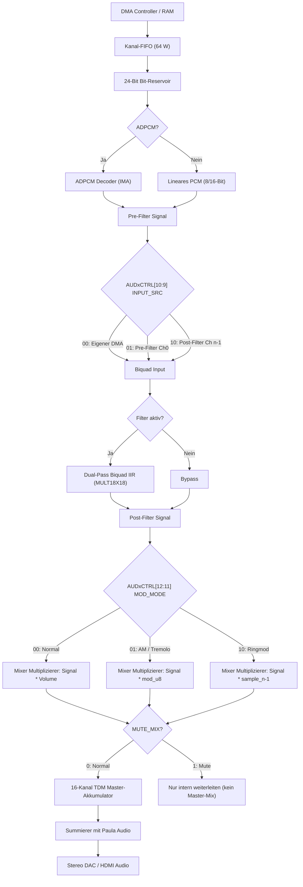

# NanoMig 16-Kanal Audio-Erweiterung & Biquad DSP Engine
## Umfassende Architektur-, Register- und Software-Dokumentation

> [!NOTE]
> Dieses Dokument beschreibt die vollständige Spezifikation, Registerbelegung, Hardware-Pipeline und Software-Ansteuerung der neuen 16-Kanal Audio-Erweiterung für NanoMig / Minimig-AGA auf dem Gowin GW2AR-LV18 FPGA (Tang Nano 20K).
> **Features:** 16 Stimmen, 32-Bit DMA-Pufferlängen, 16x 2nd-Order Biquad IIR Filter mit Stereo-Routing, serielle & parallele Kanal-Kaskadierung (Pre/Post-Filter), AM/Tremolo & Ringmodulation sowie Zero-RAM Hardware Start-Delay (bis 2,0 Sekunden).

---

## Inhaltsverzeichnis
1. [Architektur-Überblick](#1-architektur-überblick)
2. [Register-Map & Adressierung](#2-register-map--adressierung)
   - [Detaillierte Register-Beschreibungen (Kanäle 0..14)](#detaillierte-register-beschreibungen-kanäle-014)
   - [Sonderbelegung am Ende aller Kanäle (Kanal 15: Global Interrupts)](#sonderbelegung-am-ende-aller-kanäle-kanal-15-global-interrupts)
   - [Vollständige Bitbelegung des Steuerregisters `AUDxCTRL` ($+$0C)](#vollständige-bitbelegung-des-steuerregisters-audxctrl-0c)
   - [Kommando & Status `AUDxCMD` ($+$1A)](#kommando--status-audxcmd-1a)
   - [Start-Delay Register `AUDxDELAY` ($+$1C)](#start-delay-register-audxdelay-1c)
3. [Biquad IIR Filter Engine mit Stereo-Routing](#3-biquad-iir-filter-engine-mit-stereo-routing)
   - [Differenzengleichung & Festkomma (Q2.14)](#differenzengleichung--festkomma-q214)
   - [Stereo-Routing Matrix (Bits 8..7)](#stereo-routing-matrix-bits-87)
   - [Praktische Filter-Koeffiziententabellen](#praktische-filter-koeffiziententabellen)
4. [Synthesizer- & Effekt-Architektur](#4-synthesizer---effekt-architektur)
   - [Kanal-Kopplung (Pre- vs. Post-Filter: Kaskaden & Filterbänke)](#kanal-kopplung-pre--vs-post-filter-kaskaden--filterbänke)
   - [Hardware AM / Tremolo & Ringmodulation](#hardware-am--tremolo--ringmodulation)
   - [Start-Delay Engine (Zero-RAM Tape Echo & Raum-Simulation)](#start-delay-engine-zero-ram-tape-echo--raum-simulation)
5. [Hardware ADPCM Dekompressor Engine](#5-hardware-adpcm-dekompressor-engine)
6. [Pipeline- & Architektur-Diagramme](#6-pipeline---architektur-diagramme)
7. [M68000 Assembler Programmierbeispiele](#7-m68000-assembler-programmierbeispiele)
   - [Beispiel 1: 16-Bit Hi-Fi PCM mit 32-Bit Pufferlänge](#beispiel-1-16-bit-hi-fi-pcm-mit-32-bit-pufferlänge)
   - [Beispiel 2: 24 dB Moog-Filterkaskade (Kanal 0 in Kanal 1)](#beispiel-2-24-db-moog-filterkaskade-kanal-0-in-kanal-1)
   - [Beispiel 3: Hardware Tape-Delay / Echo ohne extra RAM](#beispiel-3-hardware-tape-delay--echo-ohne-extra-ram)
   - [Beispiel 4: Hardware Tremolo & Ringmodulation](#beispiel-4-hardware-tremolo--ringmodulation)
   - [Beispiel 5: Level-2 Interrupt Service Routine (Ping-Pong Buffer)](#beispiel-5-level-2-interrupt-service-routine-ping-pong-buffer)
8. [Ressourcen- & Hardware-Verifikation](#8-ressourcen---hardware-verifikation)

---

## 1. Architektur-Überblick

Die Audio-Erweiterung erweitert den Amiga Paula-Audiocontroller um **16 eigenständige High-Definition Audiokanäle**, ohne bestehende Amiga-Standards zu beeinträchtigen. Die Audioausgabe erfolgt über einen hardwarenahen TDM-Multiplexer (Time Division Multiplexing), der mit 50 MHz getaktet wird.

```
       +-----------------------------------------------------------+
       |             M68020 Host-Bus ($DFF400..$DFF5FF)            |
       +-----------------------------------------------------------+
                                     |
                +--------------------+--------------------+
                |                                         |
     +---------------------+                   +---------------------+
     | Register-Interface  |                   |   DMA Controller    |
     | (32 Bytes / Kanal)  |                   | (Chip-/Fast-RAM)    |
     +---------------------+                   +---------------------+
                |                                         |
                |        +-----------------------+        |
                +------->| TDM-Core (16 Kanäle)  |<-------+
                         | 16 TDM-Slots @ 50 MHz |
                         +-----------------------+
                                     |
               +---------------------+---------------------+
               |                                           |
    +----------------------+                    +----------------------+
    | Shared ADPCM Decoder |                    | Dual-Pass Biquad IIR |
    | (MULT18X18 DSP Core) |                    | (MULT18X18 DSP Core) |
    +----------------------+                    +----------------------+
               |                                           |
               +---------------------+---------------------+
                                     |
                         +-----------------------+
                         | AM / Ringmod / Volume |
                         | (Multiplikation)      |
                         +-----------------------+
                                     |
                         +-----------------------+
                         | 16-Kanal Stereo-Mixer |
                         | (Saturation Clamp)    |
                         +-----------------------+
                                     |
             +-----------------------+-----------------------+
             |                                               |
  [Paula 4-Kanal Audio]                            [Audio-Erweiterung]
             \                                               /
              \---+-------------------------------------+---/
                  | Digitaler Summierer & Saturation    |
                  +-------------------------------------+
                                     |
                         [Stereo Audio DAC / HDMI]
```

---

## 2. Register-Map & Adressierung

Der gesamte Adressbereich umfasst exakt **512 Bytes** von `$DFF400` bis `$DFF5FF`.  
Keine Kollision mit dem HAM-Register `$DFF680` oder Paula (`$DFF0A0..$DFF0DF`).

$$\text{Basisadresse Kanal } n = \$DFF400 + (n \times 32) \quad (0 \le n \le 15)$$

### Kanal-Basisadressen:
| Kanal | Basisadresse | Kanal | Basisadresse |
|:-----:|:------------:|:-----:|:------------:|
| 0 | `$DFF400` | 8  | `$DFF500` |
| 1 | `$DFF420` | 9  | `$DFF520` |
| 2 | `$DFF440` | 10 | `$DFF540` |
| 3 | `$DFF460` | 11 | `$DFF560` |
| 4 | `$DFF480` | 12 | `$DFF580` |
| 5 | `$DFF4A0` | 13 | `$DFF5A0` |
| 6 | `$DFF4C0` | 14 | `$DFF5C0` |
| 7 | `$DFF4E0` | 15 | `$DFF5E0` |

---

### Detaillierte Register-Beschreibungen (Kanäle 0..14)

Die folgenden Offsets gelten relativ zur Basisadresse des Kanals ($+$Offset):

| Offset | Register | R/W | Format | Standard | Funktion |
|:------:|:---------|:---:|:------:|:--------:|:---------|
| `+$00` | `AUDxPTRH` | W | 16 Bit | `$0000` | DMA-Startadresse High (Bits 23..16) |
| `+$02` | `AUDxPTRL` | W | 16 Bit | `$0000` | DMA-Startadresse Low (Bits 15..0) |
| `+$04` | `AUDxLENH` | W | 16 Bit | `$0000` | **Pufferlänge High in Words (Bits 31..16) – 32-Bit!** |
| `+$06` | `AUDxLENL` | W | 16 Bit | `$0000` | **Pufferlänge Low in Words (Bits 15..0)** |
| `+$08` | `AUDxVOL`  | W | 16 Bit | `$0000` | Lautstärke: High-Byte = Links, Low-Byte = Rechts (0..255) |
| `+$0A` | `AUDxPER`  | W | 16 Bit | `$0100` | Sample-Periode (50 MHz Teiler: $f_s = 50\,\text{MHz} / \text{PER}$) |
| `+$0C` | `AUDxCTRL` | W | 16 Bit | `$0000` | Steuerregister (Format, Filter, Input-Src, AM/Ringmod, Mute) |
| `+$0E` | `AUDxPRED` | W | 16 Bit | `$0000` | ADPCM Start-Prädiktor & Schritt-Index |
| `+$10` | `AUDxBQ_B0`| R/W| 16 Bit | `$4000` | Biquad Koeffizient $b_0$ (Q2.14, `$4000` = 1.0) |
| `+$12` | `AUDxBQ_B1`| R/W| 16 Bit | `$0000` | Biquad Koeffizient $b_1$ (Q2.14) |
| `+$14` | `AUDxBQ_B2`| R/W| 16 Bit | `$0000` | Biquad Koeffizient $b_2$ (Q2.14) |
| `+$16` | `AUDxBQ_A1`| R/W| 16 Bit | `$0000` | Biquad Koeffizient $a_1$ (Q2.14) |
| `+$18` | `AUDxBQ_A2`| R/W| 16 Bit | `$0000` | Biquad Koeffizient $a_2$ (Q2.14) |
| `+$1A` | `AUDxCMD`  | R/W| 16 Bit | `$0000` | Kommando- und Statusregister |
| `+$1C` | `AUDxDELAY`| W   | 16 Bit | `$0000` | **16-Bit Start-Delay Counter (0 .. 2,000 Sekunden @ 32.768 kHz)** |
| `+$1E` | `AUDxSTATUS`| R  | 16 Bit | `$0000` | Kanal-Status / Peak-Pegel Readback |

---

### Sonderbelegung am Ende aller Kanäle (Kanal 15: Global Interrupts)

Gemäß **Option A** liegen die globalen 16-Bit Interrupt-Register zentral **am Ende des Adressraums** bei Kanal 15 (`$DFF5E0`):
- **`$DFF5FC` (`+$1C` von Kanal 15): `AUD_INTENA`** (Globales 16-Bit Interrupt Enable)
  - Bit $n = 1$: Erlaubt Level-2 Interrupt (`INT2`) bei Pufferende von Kanal $n$.
- **`$DFF5FE` (`+$1E` von Kanal 15): `AUD_INTREQ`** (Globales 16-Bit Interrupt Request, W1C)
  - Bit $n = 1$: Puffer von Kanal $n$ beendet / Loop-Reload.
  - Schreiben einer `1` auf Bit $n$ löscht die Anforderung (Write-1-to-Clear).

---

### Vollständige Bitbelegung des Steuerregisters `AUDxCTRL` ($+$0C)

```
 15  14  13  12  11  10   9   8   7   6   5   4   3   2   1   0
+---+---+---+---+---+---+---+---+---+---+---+---+---+---+---+---+
|Res|Res|MUT|  MOD  |  SRC  |FLT|FLT|M/S|MODE[1:0]|ADP|STE|ONE|PCM|
|   |   |MIX|  [1:0]|  [1:0]| L | R |   |         |   |   |   |   |
+---+---+---+---+---+---+---+---+---+---+---+---+---+---+---+---+
```

| Bits | Name | Werte | Beschreibung |
|:---:|:---|:---:|:---|
| **0** | `PCM16` | `0`=8-Bit, `1`=16-Bit | Standard Amiga 8-Bit Signed vs. 16-Bit Hi-Fi PCM |
| **1** | `ONE_SHOT` | `0`=Loop, `1`=One-Shot | Endlos-Schleife (Paula-Style) vs. Stopp nach Pufferende |
| **2** | `STEREO` | `0`=Mono, `1`=Stereo | Mono (Panning über `AUDxVOL`) vs. Interleaved Stereo |
| **3** | `ADPCM_EN` | `0`=PCM, `1`=ADPCM | Hardware-Dekomprimierung aktivieren |
| **5:4** | `ADPCM_MODE` | `00`=4-Bit, `01`=2-Bit, `10`=5/3, `11`=5-Bit | Kompressionsmodus (4:1 bis 8:1 Speicherersparnis) |
| **6** | `MID_SIDE` | `1`=Aktiv | Mid/Side Stereo Dekodierung |
| **8:7** | `FILTER_ROUTING` | `00`=Bypass<br>`01`=Nur Rechts<br>`10`=Nur Links<br>`11`=Beide | Biquad IIR Filter Zuweisung (Dual-Pass Stereo FSM) |
| **10:9** | `INPUT_SRC` | `00`=Eigener DMA<br>`01`=**Pre-Filter Ch n-1**<br>`10`=**Post-Filter Ch n-1**<br>`11`=Reserviert | **Audio-Eingangsquelle:**<br>`01` = Parallele Filterbank (Graphic EQ, Vocoder – reicht Signal durch alle Kanäle durch)<br>`10` = Serielle Kaskade (24/48dB Filter) |
| **12:11**| `MOD_MODE` | `00`=Normal<br>`01`=**AM / Tremolo**<br>`10`=**Ringmodulation**<br>`11`=Reserviert | **Modulations-Modus:**<br>`01` = Unipolar (Lautstärke moduliert 0..100%)<br>`10` = Bipolar (Phasenumkehr / metallisch) |
| **13** | `MUTE_MIX` | `0`=Normal, `1`=Mute | Unterdrückt Ausgabe in Master-Mix (für Zwischenstufen/LFOs) |
| **15:14**| *Reserviert* | `00` | Zukünftige Erweiterungen (immer 0 schreiben) |

---

### Kommando & Status `AUDxCMD` ($+$1A)

- **Schreiben:**
  - Bit 0 (`START`): Startet den Kanal (wertet `AUDxDELAY` aus).
  - Bit 1 (`STOP`): Stoppt den Kanal unverzüglich.
  - Bit 2 (`CLEAR_IRQ`): Löscht das Interrupt-Pending-Bit dieses Kanals.
- **Lesen:**
  - Bit 0 (`ACTIVE`): `1` = Kanal spielt aktuell Audio ab.
  - Bit 1 (`PREFILL`): `1` = DMA-FIFO füllt vor dem ersten Sample-Tick vor.
  - Bit 2 (`DELAYING`): `1` = Start-Delay Counter läuft noch herunter.

---

### Start-Delay Register `AUDxDELAY` ($+$1C)

- **Taktbasis:** $32{,}768\,\text{kHz}$ ($30{,}517\,\mu\text{s}$ pro Tick).
- **Bereich:** $0 \dots 65535$ Ticks = **Exakt 0,000 bis 2,000 Sekunden**.
- **Wertetabelle:**
  - `$0000` (0): Sofortiger Start (Verzögerung 0 ms).
  - `$0021` (33): 1 Millisekunde.
  - `$0148` (328): 10 Millisekunden (Early Reflections / Haas-Stereo-Effekt).
  - `$0666` (1638): 50 Millisekunden (Slapback Echo).
  - `$2000` (8192): 250 Millisekunden (Viertel-Sekunde).
  - `$4000` (16384): 500 Millisekunden (Halbe Sekunde).
  - `$8000` (32768): **Exakt 1,000 Sekunde**.
  - `$FFFF` (65535): **Exakt 2,000 Sekunden**.

---

## 3. Biquad IIR Filter Engine mit Stereo-Routing

Jeder Kanal verfügt über ein hardwarebeschleunigtes **Biquad IIR Filter 2. Ordnung** (12 dB/Oktave).

### Differenzengleichung & Festkomma (Q2.14)

$$y[n] = b_0 \cdot x[n] + b_1 \cdot x[n-1] + b_2 \cdot x[n-2] - a_1 \cdot y[n-1] - a_2 \cdot y[n-2]$$

- **Format:** Q2.14 signed ($1.0 = 16384 = \$4000$).
- **Wertebereich:** $-2.0 \le x < +2.0$ ($-32768 \dots +32767$).
- **Dual-Pass FSM:** Bei Stereo und `AUDxCTRL[8:7] == 2'b11` filtert die FSM in 14 Takten links und in 14 Takten rechts (getrennte $x,y$-Verzögerungsleitungen im Gowin DPB Block-RAM).

---

### Stereo-Routing Matrix (Bits 8..7)

| `AUDxCTRL[8:7]` | Linker Kanal | Rechter Kanal | FSM Zyklen |
|:---:|:---|:---|:---:|
| **`00`** | Direkt (Bypass) | Direkt (Bypass) | 0 (FSM ruht) |
| **`01`** | Direkt (Bypass) | **Gefiltert** | 14 Takte |
| **`10`** | **Gefiltert** | Direkt (Bypass) | 14 Takte |
| **`11`** | **Gefiltert** | **Gefiltert** | 28 Takte (Stereo) / 14 Takte (Mono) |

---

### Praktische Filter-Koeffiziententabellen ($f_s = 44.1\,\text{kHz}$)

| Filtertyp | $f_0$ | $Q$ | `AUDxBQ_B0` | `AUDxBQ_B1` | `AUDxBQ_B2` | `AUDxBQ_A1` | `AUDxBQ_A2` |
|:----------|:---:|:---:|:---:|:---:|:---:|:---:|:---:|
| **Amiga 500 LED-Filter** | 3.2 kHz | 0.707 | `$031F` | `$063E` | `$031F` | `$B335` | `$1972` |
| **Paula Rekonstruktion** | 4.5 kHz | 0.707 | `$05BC` | `$0B78` | `$05BC` | `$97E2` | `$1F96` |
| **Studio Hi-Fi Lowpass** | 10.0 kHz| 0.707 | `$1C1A` | `$3834` | `$1C1A` | `$3834` | `$344D` |
| **Hochpass (Subsonic)**  | 80 Hz   | 0.707 | `$3EAF` | `$82A2` | `$3EAF` | `$82A7` | `$3D59` |
| **Präsenz-Boost (+6dB)**| 3.0 kHz | 1.000 | `$48A2` | `$79C1` | `$3942` | `$79C1` | `$37E4` |
| **Bypass (Flat 1:1)**   | —       | —     | `$4000` | `$0000` | `$0000` | `$0000` | `$0000` |

---

## 4. Synthesizer- & Effekt-Architektur

### Kanal-Kopplung (Pre- vs. Post-Filter: Kaskaden & Filterbänke)

Über `AUDxCTRL[10:9]` (`INPUT_SRC`) kann jeder Kanal auf Signale anderer Kanäle zugreifen:

```
               +-------------------------------------------------------+
               |                      Kanal n-1                        |
               |   [DMA / ADPCM] ---------> [Biquad Filter] ---------> |
               +---------|----------------------|----------------------+
                         |                      |
                         | (Pre-Filter: SRC=01) | (Post-Filter: SRC=10)
                         v                      v
                  +--------------+       +--------------+
                  | PARALLEL     |       | SERIELL      |
                  | Filterbank   |       | Kaskade      |
                  | (Vocoder/EQ) |       | (24dB Filter)|
                  +--------------+       +--------------+
```

1. **Pre-Filter (`SRC = 01`):** Greift das unfiltriertes Eingangssignal des Vorläuferkanals ($n-1$) ab und reicht es an nachfolgende Kanäle weiter.
   - Wenn z. B. Kanal 0 das Sample spielt und Kanäle 1 bis 15 alle `SRC = 01` setzen, empfangen **alle 15 Kanäle dasselbe originale Signal von Kanal 0**!
   - Jeder Kanal kann seine eigenen Filter-Koeffizienten (Bass, Tiefmitten, Hochmitten, Höhen usw.) anwenden.
   - `AUDxVOL` fungiert als Band-Lautstärke $\rightarrow$ **Vollwertiger 16-Band Grafik-Equalizer, Spektralanalyse oder Vocoder!**
   - Beliebige Gruppenbildung möglich: z. B. Kanäle 0–3 als 4-Band-Filter für Sprache, Kanäle 4–7 als 4-Band-Filter für Synth!
2. **Post-Filter (`SRC = 10`):** Greift das Signal **nach dem Filter von Kanal $n-1$** ab.
   - 2 Kanäle in Serie = **24 dB / Oktave Moog-Filter**.
   - 4 Kanäle in Serie = **48 dB / Oktave Brickwall-Filter**.

---

### Hardware AM / Tremolo & Ringmodulation

Über `AUDxCTRL[12:11]` (`MOD_MODE`) moduliert Kanal $n-1$ das Signal von Kanal $n$:

1. **AM / Tremolo (`MOD = 01`):**
   - Das 16-Bit signed Signal aus Kanal $n-1$ wird über $\{~\text{sample}[15], \text{sample}[14:8]\}$ verlustfrei in 8-Bit unsigned (0..255) gewandelt.
   - Dieser Wert ersetzt direkt den Lautstärkefaktor im Mixer-Multiplizierer (**0 extra Multiplizierer im FPGA!**).
   - Die Modulationstiefe und Gesamtlautstärke wird stufenlos über `AUD(n-1)VOL` geregelt.
2. **Ringmodulation (`MOD = 10`):**
   - Multipliziert Träger und Modulator bipolar mit Vorzeichen (`sample[15:8]`).
   - Erzeugt klassische Glockenklänge, Roboterstimmen und metallische Synthesizer-Sounds.

---

### Start-Delay Engine (Zero-RAM Tape Echo & Raum-Simulation)

Durch Einstellen von `AUDxDELAY` starten Kanäle zeitversetzt:
- Kanal 0 startet sofort (Trockenes Signal).
- Kanal 1 zeigt auf **denselben DMA-Puffer im RAM**, startet aber mit $N$ Ticks Verzögerung (1. Echo).
- Kanal 2 startet mit $2N$ Ticks Verzögerung (2. Echo).
- Durch Zuweisung dunklerer Biquad-Tiefpässe an Kanal 1 und 2 entsteht ein **perfektes analoges Band-Echo (Tape Delay)** mit Ausdünnung der Höhen – **ohne 1 Byte extra FPGA-RAM!**

---

## 5. Hardware ADPCM Dekompressor Engine

- **4-Bit IMA ADPCM (`MODE = 00`):** 4:1 Kompression gegenüber 16-Bit PCM (2:1 gegenüber Amiga 8-Bit).
- **2-Bit Extreme ADPCM (`MODE = 01`):** 8:1 Kompression. Perfekt für lange Sprachausgaben und Soundeffekte.
- **5/3 Hybrid (`MODE = 10`) & 5-Bit Hi-Fi (`MODE = 11`):** Hohe Dynamik für anspruchsvolle Musikstücke.
- **Barrel-Shifter & Bit-Reservoir:** 24-Bit Reservoir zieht automatisch Wörter aus dem 64-Word Hardware-FIFO nach.

---

## 6. Pipeline- & Architektur-Diagramme



---

## 7. M68000 Assembler Programmierbeispiele

### Beispiel 1: 16-Bit Hi-Fi PCM mit 32-Bit Pufferlänge
```assembly
AUD0_BASE       EQU $DFF400

PlayHiFi32Bit:
        lea     AUD0_BASE,a1
        move.w  #$0002,$1A(a1)          ; CMD: Stop
        
        ; 24-Bit DMA Zeiger setzen ($00080000)
        move.w  #$0008,$00(a1)          ; PTRH
        move.w  #$0000,$02(a1)          ; PTRL
        
        ; 32-Bit Pufferlänge setzen: 500.000 Words ($0007A120)
        move.w  #$0007,$04(a1)          ; LENH (Bits 31..16) - NEU 32-BIT!
        move.w  #$A120,$06(a1)          ; LENL (Bits 15..0)
        
        move.w  #$FFFF,$08(a1)          ; Lautstärke voll L/R
        move.w  #1134,$0A(a1)           ; Periode für 44.1 kHz @ 50 MHz
        
        ; 16-Bit PCM (Bit 0=1), One-Shot (Bit 1=1), Stereo (Bit 2=1)
        move.w  #%0000000000000111,$0C(a1)
        
        move.w  #$0000,$1C(a1)          ; Kein Start-Delay
        move.w  #$0001,$1A(a1)          ; CMD: Start
        rts
```

---

### Beispiel 2: 24 dB Moog-Filterkaskade (Kanal 0 in Kanal 1)
```assembly
AUD0_BASE       EQU $DFF400
AUD1_BASE       EQU $DFF420

SetupMoog24dB:
        ; --- Kanal 0 (Filterstufe 1: 12 dB Tiefpass, stummgeschaltet im Master) ---
        lea     AUD0_BASE,a0
        move.w  #$05BC,$10(a0)          ; B0
        move.w  #$0B78,$12(a0)          ; B1
        move.w  #$05BC,$14(a0)          ; B2
        move.w  #$97E2,$16(a0)          ; A1
        move.w  #$1F96,$18(a0)          ; A2
        ; Filter aktiv (Bits 8:7=11), MUTE_MIX=1 (Bit 13=1, nur Zwischenstufe)
        move.w  #%0010000110000001,$0C(a0)
        
        ; --- Kanal 1 (Filterstufe 2: 12 dB Tiefpass, Endausgabe im Master-Mix) ---
        lea     AUD1_BASE,a1
        move.w  #$05BC,$10(a1)          ; Identische Tiefpass-Koeffizienten
        move.w  #$0B78,$12(a1)
        move.w  #$05BC,$14(a1)
        move.w  #$97E2,$16(a1)
        move.w  #$1F96,$18(a1)
        move.w  #$FFFF,$08(a1)          ; Master-Lautstärke für Kanal 1
        ; Filter aktiv (Bits 8:7=11), INPUT_SRC = 10 (Post-Filter Kanal 0), MUTE_MIX = 0
        move.w  #%0000010110000001,$0C(a1)
        
        ; Beide Kanäle starten
        move.w  #$0001,$1A(a1)          ; Start Kanal 1
        move.w  #$0001,$1A(a0)          ; Start Kanal 0
        rts
```

---

### Beispiel 3: Hardware Tape-Delay / Echo ohne extra RAM
```assembly
AUD0_BASE       EQU $DFF400
AUD1_BASE       EQU $DFF420

SetupHardwareDelay:
        ; --- Kanal 0: Original-Signal (Sofortstart) ---
        lea     AUD0_BASE,a0
        move.w  #$0000,$1C(a0)          ; DELAY = 0 ms
        move.w  #$FFFF,$08(a0)          ; Volle Lautstärke
        move.w  #%0000000000000001,$0C(a0)
        
        ; --- Kanal 1: 1. Echo nach 250 Millisekunden ($2000 = 8192 Ticks) ---
        lea     AUD1_BASE,a1
        ; Identische DMA-Zeiger auf denselben Puffer im RAM setzen!
        move.w  $00(a0),$00(a1)         ; PTRH kopieren
        move.w  $02(a0),$02(a1)         ; PTRL kopieren
        move.w  $04(a0),$04(a1)         ; LENH kopieren
        move.w  $06(a0),$06(a1)         ; LENL kopieren
        move.w  $0A(a0),$0A(a1)         ; PER kopieren
        
        move.w  #$8192,$1C(a1)          ; AUD1DELAY: Exakt 250 ms Delay!
        move.w  #$6060,$08(a1)          ; Lautstärke auf ca. 40% reduzieren
        
        ; Kanal 1 mit Tiefpass filtern (Echo verliert Höhen wie analoges Tape!)
        move.w  #$05BC,$10(a1)
        move.w  #$0B78,$12(a1)
        move.w  #$05BC,$14(a1)
        move.w  #$97E2,$16(a1)
        move.w  #$1F96,$18(a1)
        move.w  #%0000000110000001,$0C(a1) ; Filter aktiv
        
        ; Beide Kanäle aktivieren (Kanal 1 wartet Hardware-Zähler ab)
        move.w  #$0001,$1A(a1)
        move.w  #$0001,$1A(a0)
        rts
```

---

### Beispiel 4: Hardware Tremolo & Ringmodulation
```assembly
AUD0_BASE       EQU $DFF400             ; Modulator (z.B. 5 Hz Sinus-LFO)
AUD1_BASE       EQU $DFF420             ; Träger (z.B. E-Gitarre oder Synthesizer)

SetupHardwareTremolo:
        ; Kanal 0 als stummer Modulator konfigurieren
        lea     AUD0_BASE,a0
        move.w  #$00FF,$08(a0)          ; AUD0VOL = Modulationstiefe (100%)
        move.w  #%0010000000000001,$0C(a0) ; MUTE_MIX = 1 (LFO selbst stumm)
        
        ; Kanal 1 mit AM/Tremolo aktivieren
        lea     AUD1_BASE,a1
        ; MOD_MODE = 01 (AM / Tremolo über Kanal 0)
        move.w  #%0000100000000001,$0C(a1)
        
        move.w  #$0001,$1A(a0)
        move.w  #$0001,$1A(a1)
        rts
```

---

### Beispiel 5: Level-2 Interrupt Service Routine (Ping-Pong Buffer)
```assembly
; Globale Interrupt-Register am Ende aller Audiokanäle (Kanal 15):
AUD_INTENA      EQU $DFF5FC
AUD_INTREQ      EQU $DFF5FE

Audio_ISR:
        movem.l d0-d1/a0-a1,-(sp)
        
        ; 1. Lese Interrupt-Status aller 16 Stimmen
        move.w  AUD_INTREQ,d0
        beq     .Exit
        
        ; 2. Quittieren (W1C)
        move.w  d0,AUD_INTREQ
        
        ; 3. Prüfe Kanal 0 fertig (Bit 0)
        btst    #0,d0
        beq     .Exit
        bsr     ReloadChannel0NextBuffer

.Exit:
        movem.l (sp)+,d0-d1/a0-a1
        rte
```

---

## 8. Ressourcen- & Hardware-Verifikation

- **Ziel-FPGA:** Gowin GW2AR-LV18QN88C8/I7 (Tang Nano 20K).
- **Toolchain:** Gowin EDA V1.9.12.04 (`gw_sh.exe scripts/build_020.tcl`).
- **Verifizierte Auslastung vor Erweiterung:**
  - Logic: 20.283 / 20.736 (453 LUTs frei)
  - CLS Slices: 10.308 / 10.368 (60 Slices frei)
  - BSRAM: 45 / 46 (1 Block-RAM komplett frei)
  - DSP: 10 / 24 (14 DSPs komplett frei)

---
*Dokumentation aktualisiert für NanoMig / Minimig-AGA Audio Architecture.*
